<p align="center">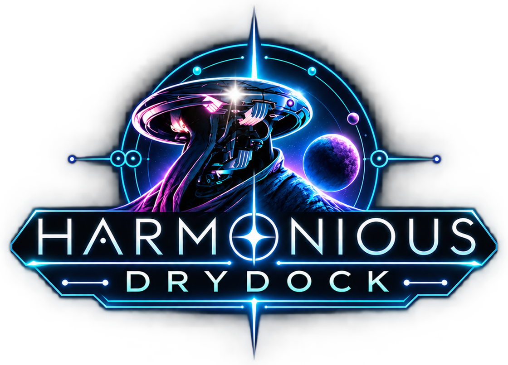</p>

<h1 align="center">Harmonious DryDock</h1>

<p align="center"><b>A save editor, ship library and Blender toolkit for No Man's Sky.</b><br>
Edit your traveller, ships, corvettes, bases and inventories. Build ships and staffs part by part.<br>
Pose your traveller in Blender, make pictures and 3D prints. Formerly Harmonious Save Editor.</p>

<table align="center">
<tr>
<td align="center" width="33%"><a href="https://github.com/Pastullio/harmonious-save-editor/releases/latest/download/HarmoniousSaveEditor.exe"><b>Download for Windows</b></a><br><sub>One program, no installer. Updates itself.</sub></td>
<td align="center" width="33%"><a href="https://github.com/Pastullio/harmonious-save-editor/releases/latest/download/HarmoniousDryDock-Mac.zip"><b>Download for Mac</b></a><br><sub>Test build, Apple Silicon and Intel. Not signed.</sub></td>
<td align="center" width="33%"><a href="https://github.com/Pastullio/harmonious-save-editor/releases/latest/download/nms-save-editor-browser.html"><b>Browser version</b></a><br><sub>One web page for Chrome or Edge. Editing only.</sub></td>
</tr>
</table>

<p align="center"><a href="https://discord.gg/3PfZfPYDn">Join the Discord</a> · <a href="https://github.com/Pastullio/harmonious-save-editor/releases/latest/download/Harmonious-Save-Editor-Guide.html">User guide</a> · <a href="docs/FEATURES.md">Every feature</a> · <a href="https://github.com/Pastullio/harmonious-save-editor/releases">All releases</a> · <a href="https://www.patreon.com/pastullio">Patreon</a></p>

> [!IMPORTANT]
> Every save is backed up before it's replaced, and nothing is uploaded anywhere. Item names, icons and 3D models come from your own copy of the game. Close No Man's Sky before you save.

## Your whole save, in one place

<table>
<tr>
<td width="58%"><a href="docs/guide/shots/overview.webp">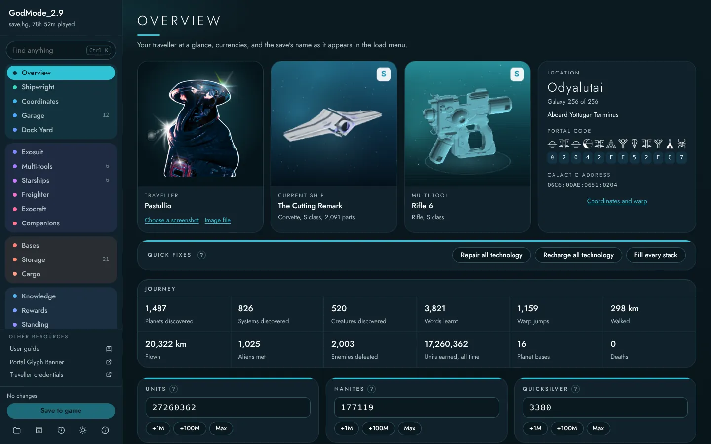</a></td>
<td width="42%" valign="top">

### Overview

Your traveller, current ship, multi-tool and location at a glance, with portal glyphs, journey milestones and a count of every build part in the save.

**Quick fixes** repair, recharge and refill every inventory at once, and set units, nanites and quicksilver.

</td>
</tr>
<tr>
<td width="58%"><a href="docs/guide/shots/find.webp">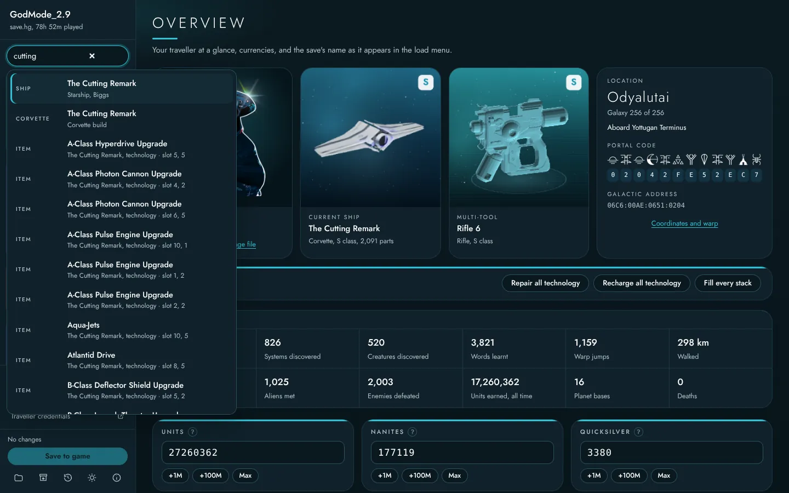</a></td>
<td width="42%" valign="top">

### Find anything

Press **Ctrl+K** and type: any ship, base, frigate, companion, setting or item you carry is one click away.

Dark and light mode, a sidebar you can rearrange, and a **?** beside anything that has more to say.

</td>
</tr>
</table>

<table>
<tr>
<td width="33%" valign="top"><b>Fleet</b><br>Starships, corvettes, freighter, frigates and exocraft, each with its real 3D model.</td>
<td width="33%" valign="top"><b>Inventories</b><br>Every grid as the game lays it out. Add, move, stack, repair and supercharge.</td>
<td width="33%" valign="top"><b>Builders</b><br>Ships and staffs from chosen parts and colours. Multi-tools by type and seed.</td>
</tr>
<tr>
<td width="33%" valign="top"><b>Coordinates</b><br>Portal glyphs, galactic addresses, system predictions and warping, in all 256 galaxies.</td>
<td width="33%" valign="top"><b>Blender</b><br>LiveLink for corvettes and bases, renders, traveller posing, pictures and 3D prints.</td>
<td width="33%" valign="top"><b>Progress</b><br>Knowledge, words, expedition rewards, standing and every difficulty setting.</td>
</tr>
</table>

## Ships, corvettes and the Dock Yard

<table>
<tr>
<td width="58%"><a href="docs/guide/shots/ships.webp">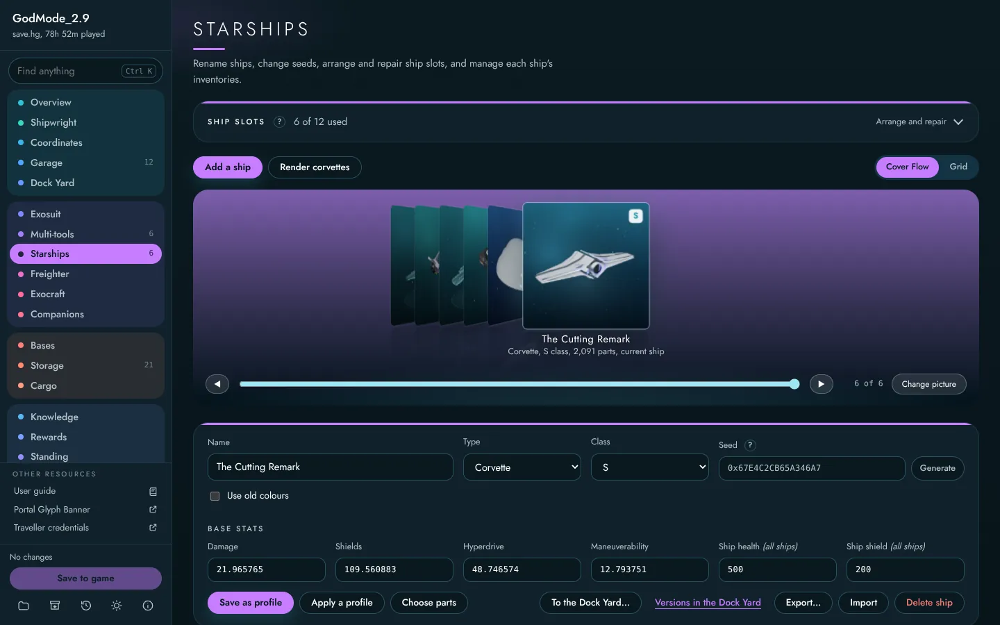</a></td>
<td width="42%" valign="top">

### Starships

Every ship you own in Cover Flow or a grid, drawn from your game's files. Change name, type, class, seed and stats, reorder slots, archive and restore, and save loadouts as profiles you can share.

Corvettes show as a hologram of their build, or as real renders with Blender and Charon Forge.

</td>
</tr>
<tr>
<td width="58%"><a href="docs/readme/ship-builder.webp">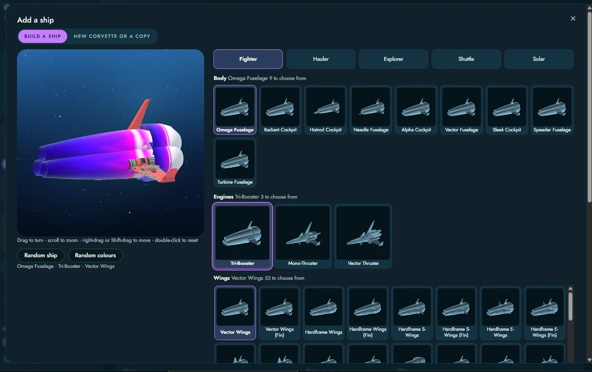</a></td>
<td width="42%" valign="top">

### Build a ship

Pick a fighter, hauler, explorer, shuttle or solar ship, then its body, engines and wings from the game's own part lists. Choose a finish and colours and watch the ship turn in 3D before it goes into an empty slot.

</td>
</tr>
<tr>
<td width="58%"><a href="docs/guide/shots/shipwright.webp">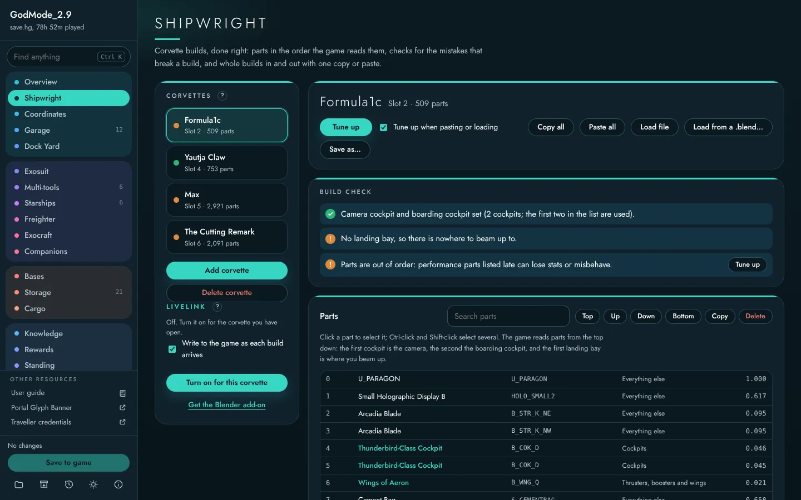</a></td>
<td width="42%" valign="top">

### Shipwright

Corvette build tools. **Tune up** puts parts in the order the game reads them so nothing loses stats. The build check finds missing cockpits, parts out of order and duplicates stacked on each other.

Copy, paste, load and save builds, including TAZ's files and Charon Forge `.blend` files.

</td>
</tr>
<tr>
<td width="58%"><a href="docs/guide/shots/dockyard-flow.webp">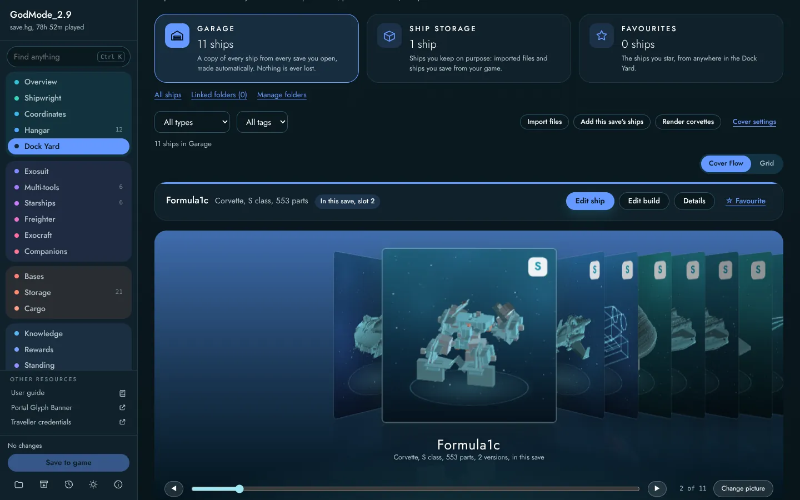</a></td>
<td width="42%" valign="top">

### Dock Yard

A library of every ship you own, build or download. The **Hangar** fills itself: each ship in each save you open is kept, with its versions, so nothing is lost when you replace one.

Tags, notes, favourites, linked folders, and **Load ship into game** for any of them. Imports and exports `.nmsship`, `.so`, `.json` and `.nmsprefab`.

</td>
</tr>
</table>

## Multi-tools and staffs

<table>
<tr>
<td width="58%"><a href="docs/readme/staff-builder.webp">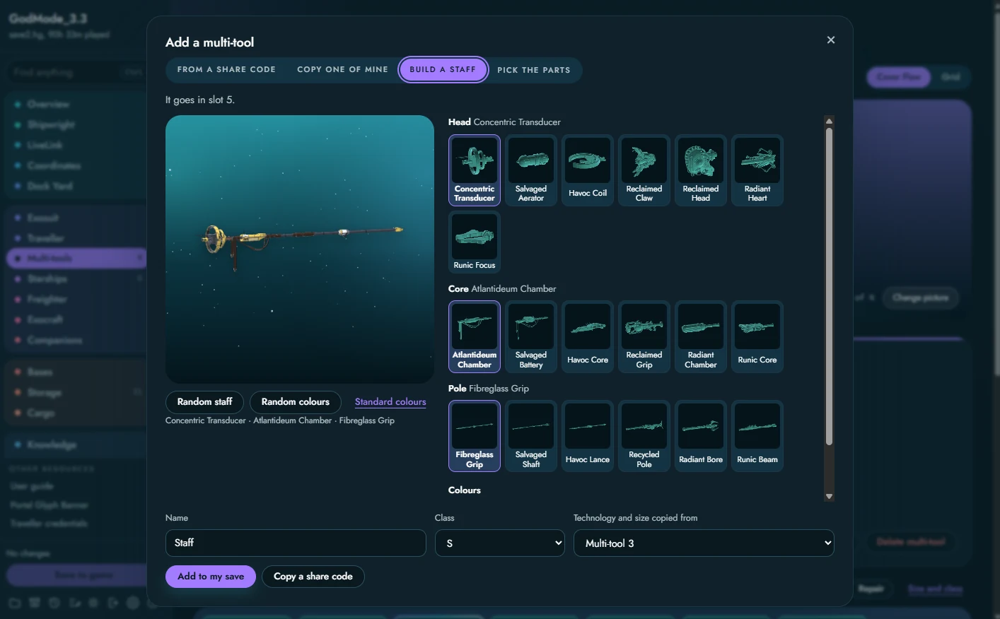</a></td>
<td width="42%" valign="top">

### Build a staff

Head, core and pole from every set in the game, in any colours, shown in 3D in its real textures. Restyle a staff you already own the same way.

**Build a weapon** makes any other multi-tool type from a seed.

</td>
</tr>
<tr>
<td width="58%"><a href="docs/guide/shots/tools.webp">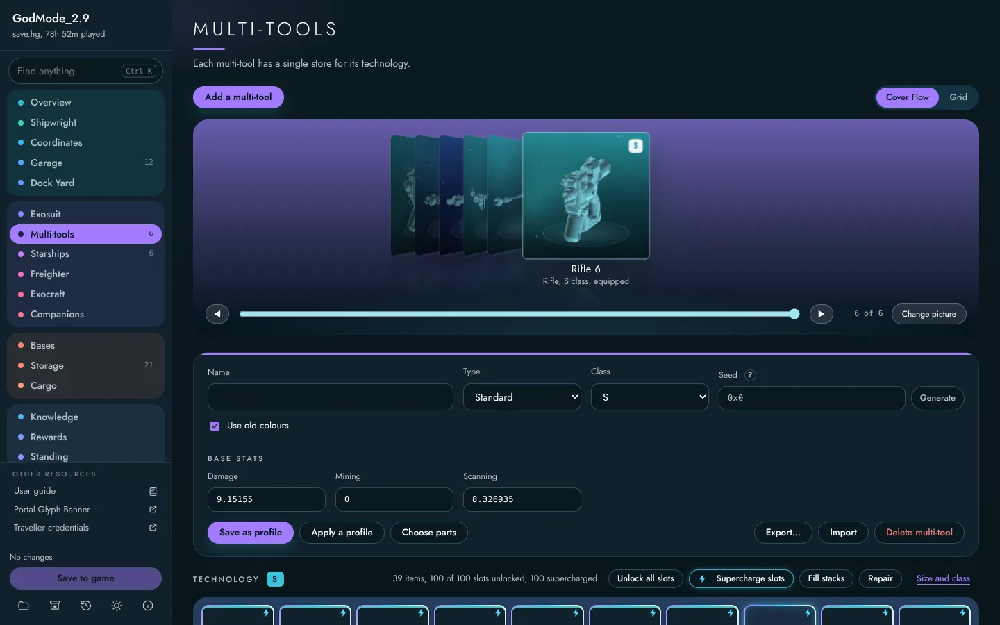</a></td>
<td width="42%" valign="top">

### Your multi-tools

Name, type, class, seed and base stats, technology with supercharged slots, and profiles.

**Share codes**: a multi-tool or staff as a short line of text to paste into Discord. Someone else pastes it and gets the same tool. Nothing is hosted and no game files change hands.

</td>
</tr>
</table>

## Your traveller, Blender and LiveLink

<table>
<tr>
<td width="58%"><a href="docs/guide/shots/traveller.webp">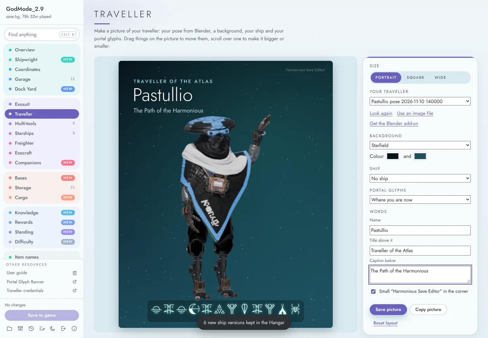</a></td>
<td width="42%" valign="top">

### Traveller cards

Your character in 3D, in the parts and colours you wear. Make a picture card with your pose, ship, multi-tool, portal glyphs and name over a space background, then save or copy it.

Share your look as a code, and collect other travellers' looks for group pictures.

</td>
</tr>
<tr>
<td width="58%"><a href="docs/readme/poses.webp">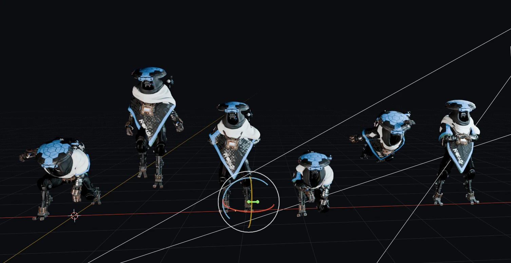</a></td>
<td width="42%" valign="top">

### Pose your traveller

The LiveLink add-on brings your traveller into Blender with a skeleton that bends the way a person does, on every race. Click a body part to turn it, drag hands and feet, or pick a ready-made pose: hero, salute, ground strike, flying and more.

Ready-made lighting, backdrops from any `.blend`, and **Render a picture**.

</td>
</tr>
<tr>
<td width="58%"><a href="docs/guide/shots/livelink.webp">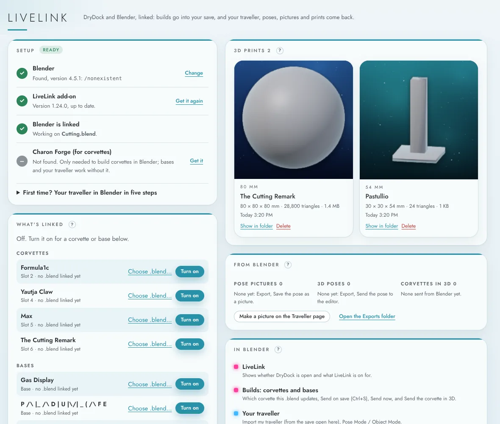</a></td>
<td width="42%" valign="top">

### LiveLink

Build a corvette in Charon Forge or a base in NMS Base Builder, press Ctrl+S in Blender, and it's in your save. DryDock backs the save up each time and asks before a build goes anywhere you didn't mean.

**3D prints**: your posed traveller or a corvette as a solid STL sized in mm, with a preview before you export.

</td>
</tr>
</table>

## Coordinates

<table>
<tr>
<td width="58%"><a href="docs/guide/shots/coords.webp">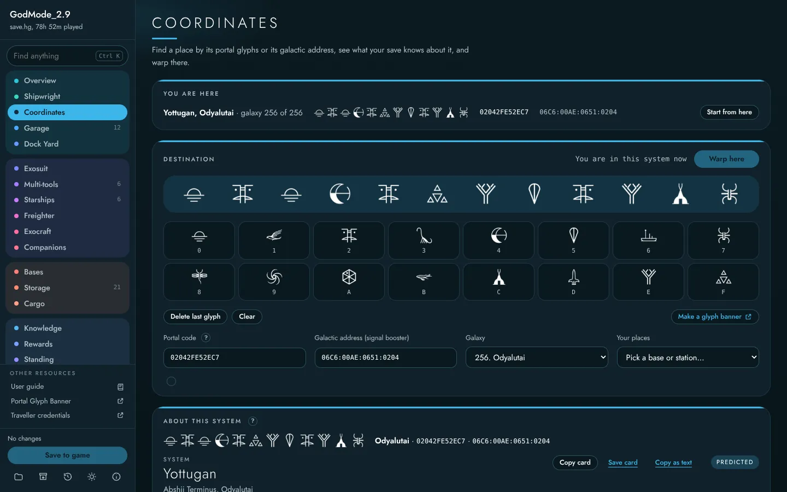</a></td>
<td width="42%" valign="top">

### Go anywhere

Type or click portal glyphs, or enter a galactic address. **Warp here** arrives in your ship, aboard your freighter or on foot at a base.

Star favourite places, give systems and planets your own nicknames, and share a place card.

</td>
</tr>
<tr>
<td width="58%"><a href="docs/guide/shots/coords-system.webp">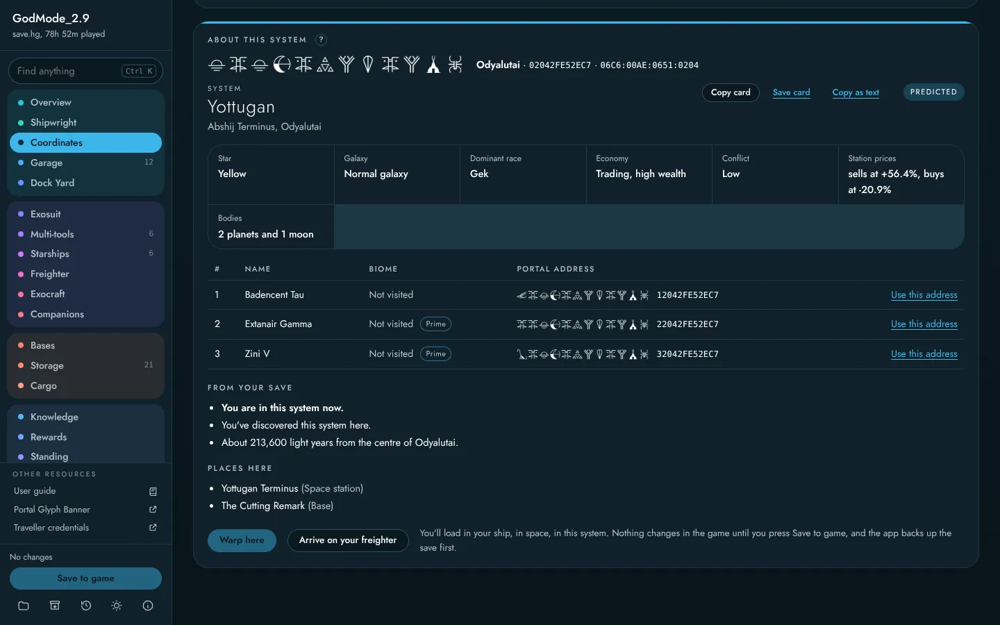</a></td>
<td width="42%" valign="top">

### Know before you go

The system's name, star colour and planets predicted from the address, next to what your save has discovered there, with the odds of each biome for every planet from the game's own table.

</td>
</tr>
</table>

## Inventories and cargo

<table>
<tr>
<td width="58%"><a href="docs/guide/shots/exosuit-slot.webp">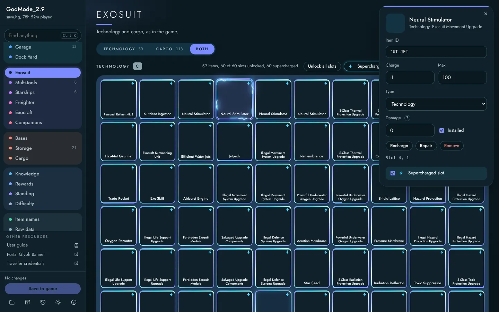</a></td>
<td width="42%" valign="top">

### Every inventory

Exosuit, ships, multi-tools, freighter, exocraft and storage, laid out as in the game with its icons and names.

Click an empty slot and type to add any item. Right-click for fill, repair, copy, duplicate, supercharge and move. Drag stacks, or drag a box to select many.

</td>
</tr>
<tr>
<td width="58%"><a href="docs/guide/shots/cargo.webp">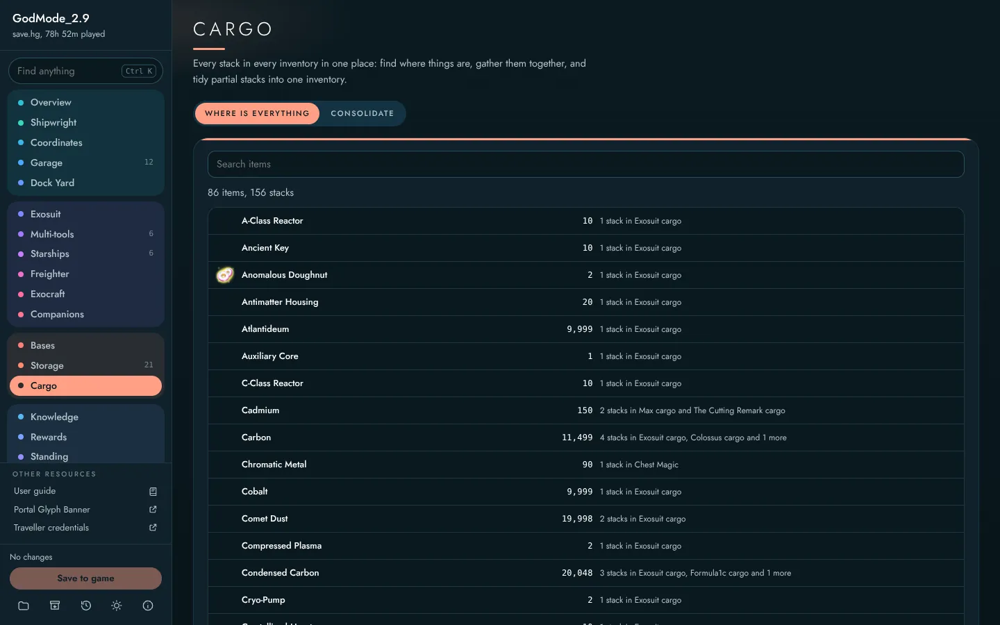</a></td>
<td width="42%" valign="top">

### Cargo

Every stack in every inventory in one list. Find where an item is, gather it into one place, or **Consolidate** partial stacks: you see the plan before anything moves.

</td>
</tr>
</table>

## Freighter, companions, bases and settlements

<table>
<tr>
<td width="58%"><a href="docs/guide/shots/frigates.webp">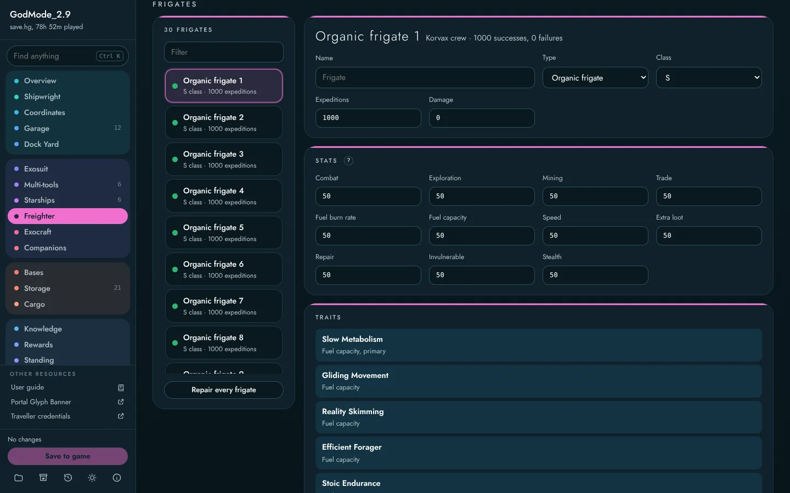</a></td>
<td width="42%" valign="top">

### Freighter and frigates

Your capital ship's class, seed and inventories, and each frigate's stats and traits. Max out, copy, duplicate or repair frigates, one or all.

</td>
</tr>
<tr>
<td width="58%"><a href="docs/guide/shots/companions.webp">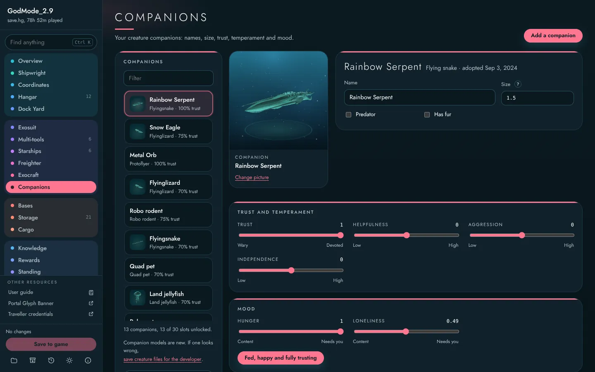</a></td>
<td width="42%" valign="top">

### Companions

Each companion's real model with the parts it was born with. Trust, mood and temperament as sliders, battle type and stat classes, and export or import a companion as a file.

</td>
</tr>
<tr>
<td width="58%"><a href="docs/guide/shots/bases.webp">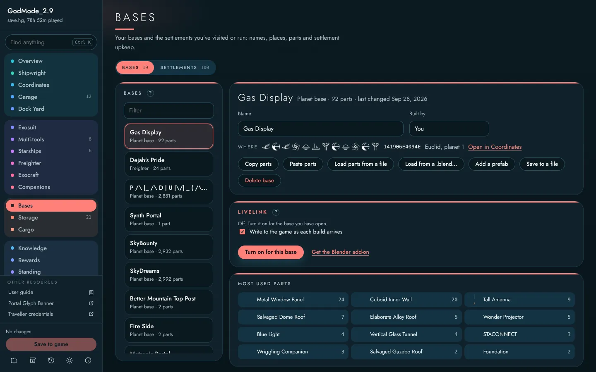</a></td>
<td width="42%" valign="top">

### Bases and settlements

Rename bases, copy parts between them, add prefabs, or load a base from Blender. For settlements you run: stats, perks, and debt and alerts cleared in one click.

</td>
</tr>
</table>

## Progress and settings

<table>
<tr>
<td width="33%" valign="top"><b>Knowledge</b><br>Learn or forget technology and base part blueprints, and alien words for every race.</td>
<td width="33%" valign="top"><b>Rewards</b><br>Expedition rewards past and present, plus Twitch drops, to claim on the Space Anomaly.</td>
<td width="33%" valign="top"><b>Standing</b><br>Reputation with each race and guild, and the journey milestones, with the game's rank names.</td>
</tr>
<tr>
<td width="33%" valign="top"><b>Difficulty</b><br>Every difficulty option, including the ones the game only offers on a new save.</td>
<td width="33%" valign="top"><b>Item names</b><br>An item library built from your own game files, rebuilt by itself after a game update.</td>
<td width="33%" valign="top"><b>Raw data</b><br>Every value in the save with readable key names. Search, edit, export and import JSON.</td>
</tr>
</table>

<p align="center"><a href="docs/FEATURES.md"><b>See every feature, page by page</b></a></p>

## Built to keep your saves safe

<table>
<tr>
<td width="50%" valign="top"><b>Backups every time</b><br>The current save is copied before it's replaced. <b>Show backups</b> opens the folder.</td>
<td width="50%" valign="top"><b>Checked before writing</b><br>The new save is decoded again and compared; if anything differs, nothing is written.</td>
</tr>
<tr>
<td width="50%" valign="top"><b>Nothing changes by accident</b><br>An unedited save re-encodes to exactly the same data, byte for byte.</td>
<td width="50%" valign="top"><b>Never an older copy over a newer one</b><br>If the game saved since you opened the save, DryDock stops and asks.</td>
</tr>
<tr>
<td width="50%" valign="top"><b>Copy, don't overwrite</b><br>Copying a save only goes into an empty slot. Exports never replace a file.</td>
<td width="50%" valign="top"><b>Stays on your PC</b><br>It only listens on your own computer, with a new key each run. Nothing is uploaded.</td>
</tr>
</table>

## Getting started

1. **Download** DryDock for your system from the top of this page and run it.
   - **Windows**: the program isn't code-signed, so SmartScreen warns the first time. Choose **More info**, then **Run anyway**.
   - **Mac**: unzip, then follow READ ME FIRST.txt to open it past Gatekeeper.
2. It finds your saves and opens in its own window. Pick a save.
3. On first start it builds an item library from your No Man's Sky install (about a minute).
4. Make your changes, then press **Save to game**. Close No Man's Sky first.

The Windows app updates itself and shows what's new after each update. Files you export go to `Documents\Harmonious Save Editor\Exports`.

## Requirements

No Man's Sky on **Steam** or **GOG** (Frontiers 3.60 or newer, checked on 7.15). Xbox / Game Pass and PlayStation saves aren't supported.

| System | File | Status |
| --- | --- | --- |
| Windows 10 / 11 | `HarmoniousSaveEditor.exe` | Tested with real saves and in the game |
| macOS (Apple Silicon and Intel) | `HarmoniousDryDock-Mac.zip` | Test build. Checked by a tester on an M3 Mac with Steam |
| Any, in Chrome or Edge | `nms-save-editor-browser.html` | Edits saves; no Dock Yard, models, renders or LiveLink |

For the Blender features: [Blender](https://www.blender.org) 4.2 or newer. Corvettes need [Charon Forge](https://github.com/xX-Charon-Xx/charon_forge) and bases need NMS Base Builder. DryDock finds them on your computer and never includes anything from them. Get the LiveLink add-on from inside DryDock (**Get LiveLink**).

## Feedback

Most features have been tried in the game, but not all of them. If something looks wrong, tell us which page and what you did in [Issues](https://github.com/Pastullio/harmonious-save-editor/issues) or on [Discord](https://discord.gg/3PfZfPYDn). **Report** on the save list makes a file that says what DryDock found on your computer (no save contents), which helps a lot.

Support the project on [Patreon](https://www.patreon.com/pastullio) or [Buy me a coffee](https://buymeacoffee.com/pastullio), and see it in action on [YouTube](https://www.youtube.com/@PastullioTheHarmonious).

## For developers

### Building

```
node build.js            # dist/nms-save-editor.html + desktop/index.html
./build-desktop.sh       # dist/Harmonious Save Editor.exe (Go 1.22+)
tools/release.sh --counts   # downloads per release (releases are made by a GitHub Action on push)
```

### Testing

```
python3 test/make_fixture.py <dir>     # synthetic save built with python-lz4 + a literal port of libNOM's meta crypto
node test/test_codec.js <dir>          # codec round-trips against those references
node test/test_ui.js <dir> <shots>     # end-to-end in headless Chromium, file mode
node test/test_folder.js <dir>         # folder mode with a mocked File System Access API
```

More end-to-end tests for each feature are in `test/e2e`. `CLAUDE.md` describes the code layout and `ROADMAP.md` the plans.

### Format notes

- **Data file**: 512 KiB chunks, each `E5 A1 ED FE` + u32 compressed size + u32 decompressed size + u32 0, then an LZ4 block. The JSON ends with a NUL.
- **Meta file**: XXTEA over little-endian u32 words, 8 rounds for 104-byte metas and 6 otherwise. The key's first word comes from the storage slot (`save.hg` = 2, `save2.hg` = 3, …). The editor decrypts, patches only the decompressed size, the on-disk size, the timestamp and the save name, and keeps every other byte untouched.
- **JSON** is parsed losslessly: key order, number spelling (`1.0`, 64-bit integers), string escapes and raw tech-pack ID bytes all survive.

Format details are ported from [libNOM.io](https://github.com/zencq/libNOM.io) and the key names come from [libNOM.map](https://github.com/zencq/libNOM.map), both GPL-3.0.

## Credits

- [libNOM.map and libNOM.io](https://github.com/zencq) by zencq: save keys and format
- [MBINCompiler](https://github.com/monkeyman192/MBINCompiler) by monkeyman192 and contributors: game table layouts
- [HGPAKtool](https://github.com/monkeyman192/HGPAKtool) by monkeyman192: game archive format
- [Charon Forge](https://github.com/xX-Charon-Xx/charon_forge) by xX-Charon-Xx: corvette renders and builds from Blender
- TAZmd's [corvette optimizer](https://tazmd.nl/corvette-optimizer) notes: the part order the game reads
- [nms_namegen](https://github.com/hadsh/nms_namegen) by Stuart Coyle, hadsh and GoodGuysFree, and its JavaScript port [nms-core](https://github.com/elegra1965-source/nms-core) by elegra1965: system and planet prediction (MIT, in `vendor/nms-core`)
- Pillow (texture decoding), klauspost/compress (zstd), Jost by indestructible type* (typeface)

<p align="center"><sub>Free software under GPL-3.0. No Man's Sky is a trademark of Hello Games. This is a fan-made tool; it isn't made or endorsed by Hello Games.</sub></p>
