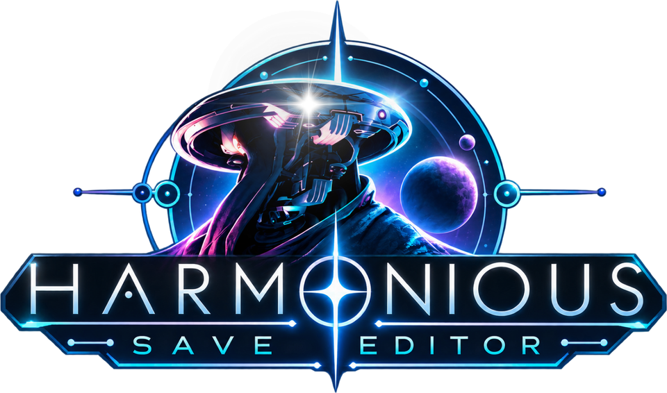

<p align="center"></p>

# Harmonious Save Editor

A single-file, in-browser save editor for No Man's Sky (Steam and GOG on PC, Frontiers 3.60 or newer).

Open `dist/nms-save-editor.html` in Chrome or Edge. Nothing is uploaded anywhere.

## What it edits

- Units, nanites, quicksilver and the save name
- Exosuit, starship, multi-tool, freighter, exocraft and storage inventories: add, remove, refill, repair, unlock slots, resize, change class
- Ship and multi-tool names and seeds
- Any value in the save through the raw data explorer, with search, plus JSON export and import

Item names and icons come from your own No Man's Sky install: the desktop app reads the game's files the first time it starts and keeps a library on your PC, rebuilt after game updates. Nothing from the game is included with the app. The browser version can use Goatfungus's `NMSSaveEditor.jar` instead.

## Desktop app (recommended on Windows)

`Harmonious Save Editor.exe` is a small program (about 6 MB, no install) that finds your saves in `%APPDATA%\HelloGames\NMS` on its own, opens the editor in its own window, and saves straight back into the game folder. Chrome blocks web pages from reading AppData, but the app isn't a web page, so that limit doesn't apply.

- Before replacing a save, it copies the current pair to `%LOCALAPPDATA%\HarmoniousSaveEditor\backups\<account>\<time>_saveN`. **Show backups** in the sidebar opens that folder.
- It warns you if No Man's Sky is still running when you save.
- It only reads and writes `saveN.hg` / `mf_saveN.hg` files, and only replaces a pair that already exists.
- It listens on 127.0.0.1 only. Each run uses a random token, so other web pages can't talk to it.
- It quits on its own a few seconds after you close its window.
- Windows SmartScreen will warn the first time because the exe isn't code-signed: choose **More info**, then **Run anyway**.

Build it with `node build.js && ./build-desktop.sh` (Go 1.22 or newer; no other dependencies).

## How saving works in the browser version

- **Folder mode** (Chrome/Edge): choose `%APPDATA%\HelloGames\NMS` or the `st_…` folder inside it. Saving copies the current `saveN.hg` and `mf_saveN.hg` into `_editor_backups\<timestamp>_saveN\` first, then writes the new pair.
- **File mode**: drop both files; the edited pair downloads and you copy it back.

Before anything is written, the new bytes are decoded again and compared with what is in memory; if they differ, nothing is written.

Close the game first. Steam Cloud may also restore an older copy if it syncs before the game starts.

## Format notes

- Data file: 512 KiB chunks, each `E5 A1 ED FE` + u32 compressed size + u32 decompressed size + u32 0, then an LZ4 block. The JSON ends with a NUL.
- Meta file: XXTEA over little-endian u32 words, 8 rounds for 104-byte metas and 6 otherwise. The key's first word comes from the storage slot (`save.hg` = 2, `save2.hg` = 3, …). The editor decrypts, patches only the decompressed size, the on-disk size, the timestamp and the save name, and keeps every other byte untouched.
- JSON is parsed losslessly: key order, number spelling (`1.0`, 64-bit integers), string escapes and raw tech-pack ID bytes all survive. An unedited save re-encodes to identical JSON.

Format details are ported from [libNOM.io](https://github.com/zencq/libNOM.io) and the key names come from [libNOM.map](https://github.com/zencq/libNOM.map) (MBINCompiler mapping 6.11.0.1), both GPL-3.0. This project is GPL-3.0 as well.

## Building and testing

```
node build.js                          # writes dist/nms-save-editor.html
python3 test/make_fixture.py <dir>     # synthetic save built with python-lz4 + a literal port of libNOM's meta crypto
node test/test_codec.js <dir>          # codec round-trips against those references
node test/test_ui.js <dir> <shots>     # end-to-end in headless Chromium, file mode
node test/test_folder.js <dir>         # folder mode with a mocked File System Access API
```

## Credits

- [libNOM.map and libNOM.io](https://github.com/zencq) by zencq: save keys and format
- [MBINCompiler](https://github.com/monkeyman192/MBINCompiler) by monkeyman192 and contributors: game table layouts
- [HGPAKtool](https://github.com/monkeyman192/HGPAKtool) by monkeyman192: game archive format
- [Charon Forge](https://github.com/xX-Charon-Xx/charon_forge) by xX-Charon-Xx: corvette renders
- [nms_namegen](https://github.com/hadsh/nms_namegen) by Stuart Coyle, hadsh and GoodGuysFree, and its JavaScript port [nms-core](https://github.com/elegra1965-source/nms-core) by elegra1965: system and planet prediction (MIT, in `vendor/nms-core`)
- Pillow (texture decoding), klauspost/compress (zstd), Jost by indestructible type* (typeface)

Free software under GPL-3.0. Not affiliated with Hello Games.
